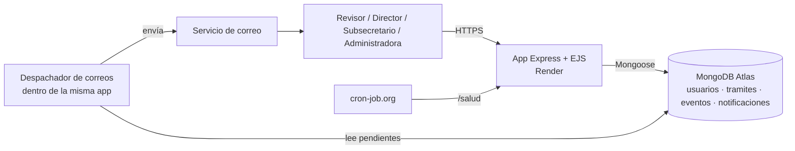
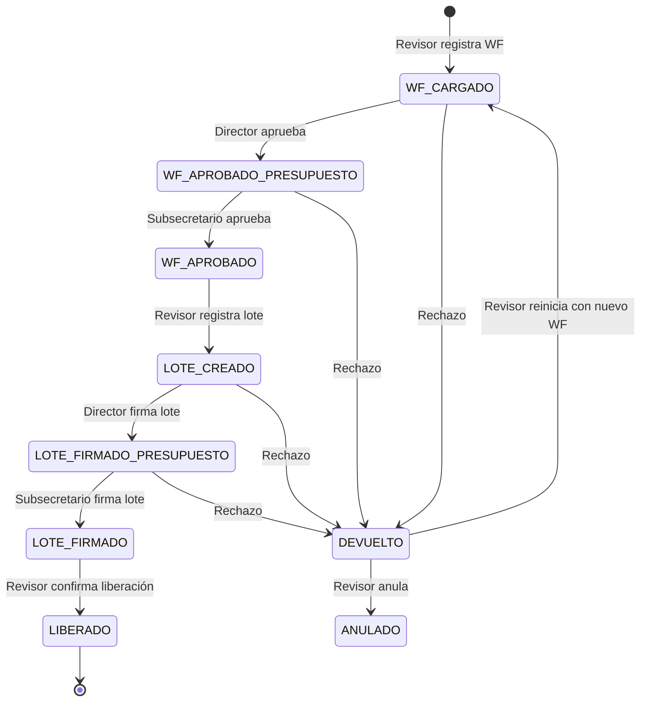
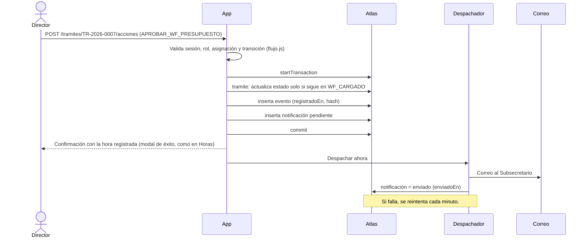

# Arquitectura – Bitácora de auditoría de trámites de pago BOGDATA

> Versión 0.3 · Octubre 2026
> Cambios: 0.2 adopta el stack, estilo y login de **Horas-Compensacion**. 0.3 cierra el login (solo correo) y la base (`bitacora_pagos` en el cluster de Horas).

## 1. Propósito y alcance

Aplicación web donde cada responsable **registra manualmente** el avance de un trámite de pago
después de hacerlo en BOGDATA. Con cada registro el sistema guarda quién, cuándo y qué dato
(WF, lote, documentos), y envía de inmediato un correo al siguiente responsable. La administradora
consulta el consolidado y la línea de tiempo de cada trámite.

**Fuera de alcance:** cualquier conexión con BOGDATA/SAP. La app no lee ni escribe en BOGDATA.

## 2. Principios de diseño

| # | Principio | Cómo se cumple |
|---|---|---|
| P1 | La hora la pone el servidor | `registradoEn` se asigna en el servidor. Ningún formulario envía esa hora. |
| P2 | La identidad sale de la sesión | El usuario del evento se toma de `req.session.usuario`, nunca de un campo del formulario. |
| P3 | La bitácora es inmutable | El usuario de la app en Atlas solo tiene `find` + `insert` sobre `eventos`. Los errores se corrigen con un evento nuevo. |
| P4 | Evidencia de manipulación | Cada evento guarda el hash del anterior (cadena de hashes). Una pantalla de la administradora verifica la cadena. |
| P5 | Un solo lugar define el flujo | La máquina de estados (`services/flujo.js`) define transiciones, roles, campos y correo. |
| P6 | Ningún correo se pierde | Patrón *outbox*: el correo se encola en la misma transacción del evento y se reintenta si falla. |

## 3. Vista general



Un solo servicio (monolito), igual que Horas-Compensacion: pantallas, rutas y despachador de correos
en la misma aplicación.

## 4. Stack (el mismo de Horas-Compensacion)

| Capa | Tecnología | Nota |
|---|---|---|
| Servidor | Node 22 + Express 5, ES modules | Misma estructura `routes / controllers / services / models / middlewares`. |
| Vistas | EJS + parciales (`head`, `header`, `sidebar`, `layout-inicio/fin`, `iconos`) | Se copian y se ajustan textos y enlaces. |
| Estilo | `public/css/style.css` del proyecto, mismas variables (`--rojo`, `--dorado`, PT Sans Narrow + Inter) | Se agregan solo componentes nuevos: línea de tiempo, insignias de estado, formulario de paso. |
| Base de datos | MongoDB Atlas + Mongoose 8 | Transacciones (Atlas es replica set). |
| Sesión | `express-session` + `connect-mongo` | Igual, cambiando el nombre de la cookie a `bitacora.sid`. |
| Correo | Nodemailer (SMTP institucional) o API HTTP de correo | Ver sección 9: verificar si Render permite SMTP. |
| Excel | ExcelJS | Lee la plantilla de usuarios y exporta el consolidado. |
| Pruebas | `node --test` | Igual. |
| Despliegue | Render (`render.yaml`) + `/salud` + cron-job.org | Igual. |

## 5. Login y roles

### Login

Misma pantalla y mismo flujo de Horas-Compensacion (`authController.iniciarSesion`), cambiando la
cédula por el **correo institucional**:

1. La persona escribe su correo.
2. Se normaliza (`trim().toLowerCase()`) y se busca en `usuarios` con `activo: true`.
3. Si existe: `req.session.regenerate()` y se guarda `{ correo, nombre, rol }` en la sesión.
4. Si no existe: "El correo no está registrado".

**Decisión (20-oct-2026):** login solo con el correo, sin código, porque únicamente entran las
personas cargadas en `usuarios`. Riesgo aceptado: quien conozca el correo de otra persona podría
entrar como ella. Si se quiere reforzar más adelante, el segundo paso con código por correo se
agrega sin cambiar el diseño.

### Roles

| Rol | Puede |
|---|---|
| `revisor` | Crear trámite (registrar WF), registrar lote, registrar liberación, reiniciar o anular tras rechazo. |
| `director` | Registrar aprobación o rechazo como responsable de presupuesto (WF y lote). |
| `subsecretario` | Registrar aprobación o rechazo como ordenador del gasto, solo en los trámites que tiene asignados. |
| `admin` | Ver todo, tablero, exportar, administrar usuarios. No registra pasos. |

Cada trámite guarda quiénes son su director y su ordenador del gasto asignados, porque hay varios
subsecretarios. Solo la persona asignada puede registrar su firma.

### Quiénes van en `usuarios` y cómo se cargan

Solo las personas que participan en el trámite (revisores, director financiero, subsecretarios y
administradora), **no** toda la planta. Las personas que solo reciben copia (p. ej. Tesorería) se
guardan en `configuracion` como destinatarios de correo, sin cuenta.

**Carga inicial (en el desarrollo, antes de salir a producción):**

1. El encargado del área diligencia `docs/Plantilla_Usuarios_Bitacora.xlsx`.
2. El archivo diligenciado se guarda en `datos/` (carpeta ignorada por git: tiene datos personales).
3. `npm run cargar-usuarios -- datos/usuarios.xlsx` lee las hojas *Usuarios* y *Solo copia*,
   valida (correo bien formado, rol válido, subsecretaría obligatoria para `subsecretario`, sin
   correos repetidos) y hace *upsert* en Atlas. Se puede correr varias veces sin duplicar.
4. El script imprime un resumen (creados, actualizados, rechazados con su motivo).

La app arranca con todos los usuarios y roles ya creados.

**Personas nuevas después de la salida:**

- **Pantalla Usuarios (admin):** botón *Nuevo usuario* con los mismos campos de la plantilla.
  También permite cambiar el rol, editar datos y desactivar.
- Cada alta, cambio de rol o desactivación queda como evento en la bitácora (`USUARIO_CREADO`,
  `ROL_CAMBIADO`, `USUARIO_DESACTIVADO`), con quién lo hizo y cuándo.
- No hay autorregistro: el rol define quién puede firmar. Si alguien no registrado intenta entrar,
  ve "El correo no está registrado, solicita acceso a la administradora".
- Al retirarse una persona se desactiva, no se borra, para que sus firmas sigan en la bitácora.

## 6. Flujo de estados



### Tabla de transiciones (fuente: `services/flujo.js`)

| Desde | Acción | Rol | Datos obligatorios | Correo a |
|---|---|---|---|---|
| — | `REGISTRAR_WF` | revisor | N.° WF, segmento, valor total, n.° registros, director y ordenador asignados | Director |
| `WF_CARGADO` | `APROBAR_WF_PRESUPUESTO` | director | — (observación opcional) | Subsecretario |
| `WF_APROBADO_PRESUPUESTO` | `APROBAR_WF_ORDENADOR` | subsecretario | — | Revisor |
| `WF_APROBADO` | `REGISTRAR_LOTE` | revisor | N.° lote, documentos contables (3000XXXXX) | Director |
| `LOTE_CREADO` | `FIRMAR_LOTE_PRESUPUESTO` | director | — (PDF opcional, v2) | Subsecretario |
| `LOTE_FIRMADO_PRESUPUESTO` | `FIRMAR_LOTE_ORDENADOR` | subsecretario | — (PDF opcional, v2) | Revisor + Administradora |
| `LOTE_FIRMADO` | `REGISTRAR_LIBERACION` | revisor | ¿Aviso de embargos? (sí/no) | Administradora + Tesorería |
| Cualquier etapa de firma | `RECHAZAR` | Firmante de esa etapa | Motivo, tipo (sin anulación / con anulación) | Revisor + niveles anteriores |
| `DEVUELTO` | `REINICIAR` | revisor | Nuevo N.° WF | Director |
| `DEVUELTO` | `ANULAR` | revisor | Motivo | Administradora |
| Cualquiera | `CORREGIR` | Quien registró el evento | Campo, valor nuevo, justificación | Administradora |

**Por validar con el área:** si un rechazo en la firma del lote obliga a reiniciar desde el WF o
solo a rehacer el lote. Hoy se modela como devolución completa.

## 7. Modelo de datos (colecciones MongoDB)

Mismo estilo de modelos que Horas (`Schema` con `collection`, `versionKey: false`, `timestamps`).

**usuarios** (`models/Usuario.js`)

| Campo | Tipo | Nota |
|---|---|---|
| `_id` | String | Correo en minúsculas (el login es una búsqueda directa, como la cédula en Horas). |
| `nombre` | String | |
| `cargo` | String | Ej. "Subsecretario de Gestión Institucional". |
| `rol` | enum | `revisor`, `director`, `subsecretario`, `admin`. |
| `activo` | Boolean | Al retirarse alguien se desactiva, no se borra (sus eventos lo referencian). |

**tramites** (`models/Tramite.js`) – estado actual, se actualiza en la misma transacción del evento.

`_id` (código `TR-2026-0001`), `wfActual`, `wfAnteriores[]`, `segmento`, `valorTotal`
(Decimal128), `numRegistros`, `descripcion`, `lote`, `documentosContables[]` (3000XXXXX),
`estado`, `revisor`, `director`, `ordenador` (correos), `ultimoEventoEn`, `timestamps`.

**eventos** (`models/Evento.js`) – bitácora inmutable

| Campo | Tipo | Nota |
|---|---|---|
| `_id` | ObjectId | |
| `secuencia` | Number | Consecutivo global (colección `contadores`), base de la cadena de hashes. |
| `tramite` | String | |
| `accion` | enum | `REGISTRAR_WF`, `APROBAR_WF_PRESUPUESTO`, … |
| `estadoAnterior` / `estadoNuevo` | enum | |
| `usuario` | `{ correo, nombre, rol }` | Copia de la sesión (queda aunque el usuario cambie después). |
| `registradoEn` | Date | Hora del servidor. |
| `horaDeclaradaBogdata` | Date, opcional | Hora en que la persona dice que lo hizo en BOGDATA. No puede ser futura ni anterior al evento previo. |
| `datos` | Mixed | Campos propios de la acción (WF, lote, motivo…). |
| `observacion` | String | |
| `ip`, `agente` | String | Contexto técnico para auditoría. |

Los eventos de administración (`USUARIO_CREADO`, `ROL_CAMBIADO`, `USUARIO_DESACTIVADO`…) van en la misma
colección con `tramite: null`, así también se audita quién dio permisos a quién. La carga desde Excel
los registra a nombre de `sistema` ("Carga inicial (script)").
| `hashAnterior`, `hash` | String | SHA-256 de (`hashAnterior` + contenido canónico del evento). |

Protección de la bitácora:

1. **En Atlas:** rol personalizado para el usuario de la app con `find` + `insert` sobre `eventos`
   (sin `update`, `remove` ni `drop`) y `readWrite` sobre el resto. Es el mismo enfoque de Horas de
   no usar el usuario administrador, más estricto en esta colección.
2. **En el código:** middleware de Mongoose que lanza error ante `updateOne`, `findOneAndUpdate`,
   `deleteOne`, etc. sobre `Evento` (defensa adicional).
3. **Cadena de hashes:** si alguien con acceso de administrador a Atlas cambia un evento, la
   verificación lo detecta.

**notificaciones** (`models/Notificacion.js`) – outbox

`evento`, `para[]`, `cc[]`, `asunto`, `cuerpoHtml`, `estado` (`pendiente` / `enviado` /
`fallido`), `intentos`, `ultimoError`, `enviadoEn`. La administradora ve si cada correo salió y a qué hora.

**configuracion** – un documento editable (como en Horas): destinatarios fijos (Tesorería, copia a
la administradora), horas para considerar un trámite "detenido", segmentos válidos.

**contadores** – consecutivos de trámite (`TR-2026-0001`) y de eventos.

## 8. Cómo se registra un paso



La actualización del trámite es condicional (`{ _id, estado: "WF_CARGADO" }`): si dos personas
registran el mismo paso a la vez, solo una gana y la otra recibe "Este paso ya fue registrado".

## 9. Correos

- Plantillas en `services/correo/plantillas/`, una por acción, con variables como `wf`, `lote`,
  `valorTotal`, `registradoPor`, `registradoEn`, `enlace`.
- **Pendiente:** formatos definitivos que entregará el área (asunto, cuerpo, destinatarios, CC).
- Todos llevan un enlace directo al trámite para que el destinatario registre su paso.
- Remitente: buzón institucional de servicio.
- **Verificar antes de construir:** el plan gratuito de Render puede bloquear conexiones SMTP
  salientes. Si es así, se envía por API HTTP (Microsoft Graph si hay M365, o un proveedor como
  Brevo/Resend con dominio verificado) o se usa un plan pago de Render.
- El despachador corre dentro de la app con un intervalo de 1 minuto. Funciona porque cron-job.org
  ya mantiene despierto el servicio, como en Horas.

## 10. Pantallas

Todas usan el layout de Horas: barra superior roja con título del área y logo, menú lateral,
tarjetas blancas redondeadas sobre fondo gris, botones píldora rojos, cifras en dorado.

| Pantalla | Ruta | Rol | Contenido |
|---|---|---|---|
| Login | `/login` | Todos | Igual a Horas, campo "Correo institucional". |
| Mi bandeja | `/bandeja` | revisor, director, subsecretario | Tarjetas de resumen (pendientes, detenidos) y tabla de trámites que esperan mi acción con tiempo de espera. |
| Nuevo trámite | `/tramites/nuevo` | revisor | Formulario de registro del WF. |
| Detalle | `/tramites/:id` | Todos | Datos, estado, botón de la acción disponible y línea de tiempo. |
| Dashboard | `/admin/dashboard` | admin | Tarjetas (en curso, detenidos, liberados del mes, rechazos), tabla filtrable, exportar a Excel. |
| Bitácora | `/admin/eventos` | admin | Todos los eventos, filtros, verificación de la cadena de hashes. |
| Usuarios | `/admin/usuarios` | admin | Alta, desactivación y rol. |

### Indicadores del dashboard (calculados desde `eventos`)

- Tiempo en cada etapa = diferencia entre eventos consecutivos del mismo trámite.
- Tiempo promedio de respuesta por firmante y por etapa.
- Trámites detenidos más de N horas en la misma etapa (N en `configuracion`).
- Rechazos por etapa y por motivo.
- Volumen y valor por periodo y por estado.
- Diferencia entre `horaDeclaradaBogdata` y `registradoEn` (registros tardíos).

## 11. Estructura del repositorio

Calcada de Horas-Compensacion:

```
/
├─ app.js
├─ config/          config.js · db.js · session.js
├─ controllers/     authController · bandejaController · tramiteController · adminController
├─ middlewares/     auth.js (requiereSesion, soloRol) · errores.js
├─ models/          Usuario · Tramite · Evento · Notificacion · Configuracion · Contador
├─ routes/          router · auth · bandeja · tramites · admin
├─ services/
│  ├─ flujo.js              máquina de estados (única fuente de verdad)
│  ├─ registrarEvento.js    transacción trámite + evento + outbox
│  ├─ hash.js
│  ├─ tiempo.js             (copiado de Horas: formato en hora de Bogotá)
│  ├─ indicadores.js
│  └─ correo/  despachador.js · plantillas/
├─ views/           auth · bandeja · tramites · admin · errores · partials
├─ public/          css/style.css · js/ · img/logo.png · assets/fonts
├─ scripts/         cargarUsuarios.js (Excel → Atlas) · verificarBitacora.js
├─ datos/           Excel diligenciado (ignorado por git)
├─ test/            flujo.test.js · hash.test.js · registrarEvento.test.js
├─ docs/            ARQUITECTURA.md
├─ render.yaml · .env.example · .gitignore · package.json
```

## 12. Seguridad y cumplimiento

- Solo HTTPS (`trust proxy` en producción, cookie `secure`, `httpOnly`, `sameSite: lax`), como en Horas.
- Toda autorización se valida en el servidor (rol + asignación del trámite).
- Datos de beneficiarios: son datos personales (Ley 1581 de 2012); guardar solo lo necesario.
- Secretos en variables de entorno de Render; `.env` nunca se sube.
- Base de datos en un cluster o base distinta de la de Horas, con su propio usuario.

## 13. Plan de 2 semanas

| Días | Entregable |
|---|---|
| 1 | Proyecto base copiado de Horas (layout, CSS, sesión, login por correo), modelos, usuario de Atlas restringido, script de carga de usuarios. |
| 2–3 | `flujo.js` con pruebas, registro de eventos con transacción y hash, bandeja y detalle con línea de tiempo. |
| 4–5 | Correos con outbox (plantillas provisionales). **Demo funcional.** |
| 6–7 | Dashboard, bitácora, pantalla de usuarios, exportación a Excel, plantillas definitivas de correo. **Carga de los usuarios reales.** |
| 8–9 | Pruebas con revisor, director y subsecretario. Ajustes. |
| 10 | Despliegue en Render y capacitación corta. |

**Versión 2:** subir PDF firmado y leer la hora real de la firma digital; recordatorios por tiempo
de espera; notificaciones en Teams.

## 14. Decisiones pendientes

1. ~~Login~~: decidido, solo correo.
2. **Correo:** Render gratuito bloquea SMTP (puertos 25, 465 y 587). Enviar por API: Brevo para empezar, o Microsoft Graph si TI lo autoriza. Falta definir el remitente.
3. Formatos definitivos de correo.
4. Comportamiento ante rechazo en la firma del lote (sección 6).
5. ¿Se pide la hora declarada de BOGDATA en cada paso, o solo la hora de registro?
6. ¿Hay encargos (p. ej. alguien firma por el director en vacaciones)? Si sí, el trámite debe
   permitir reasignar el firmante con un evento de reasignación.
